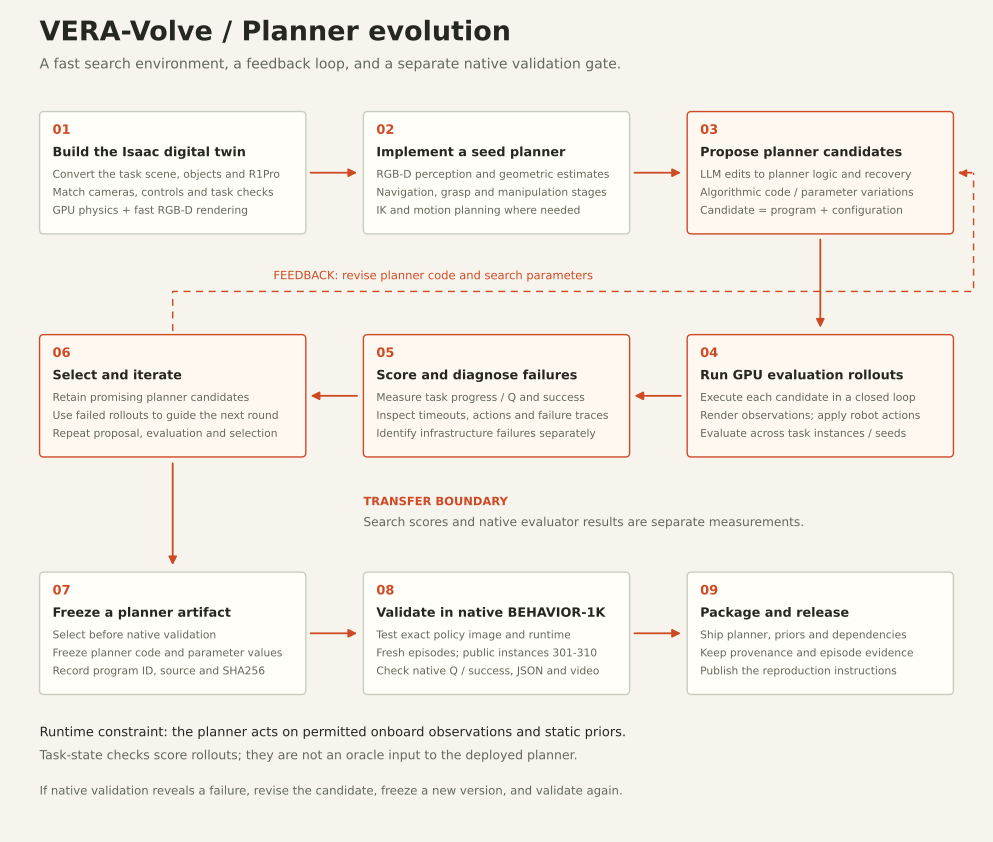

# VERA-Volve · Planner evolution for BEHAVIOR-1K

[](https://wingrune.github.io/VERA-B1K-2026/)

An open-source release of **VERA's planner solution** to the [2026 BEHAVIOR Challenge](https://behavior.stanford.edu/challenge/index.html). We build an **Isaac digital twin** for GPU simulation and fast RGB-D rendering, evolve executable planner code with **LLM proposals and algorithmic search**, and validate selected planners in native BEHAVIOR-1K.

**[Project blog](https://wingrune.github.io/VERA-B1K-2026/)** · **[Technical report](docs/technical-report.pdf)** · **[Reproduction guide](docs/reproduce.md)** · **[Validation JSONs and videos](https://huggingface.co/datasets/VERA-VLA/b1k_final_submission)** · **[Challenge leaderboard](https://huggingface.co/spaces/behavior-1k/2026-challenge-leaderboard)**

## What is released

| Material | Location |
|---|---|
| Policy server, routing, planners, controllers, VLA adapters and dependencies | This repository |
| All five routed model checkpoints and the packaged inference environments | [Public submission image](https://github.com/users/alstar8/packages/container/package/b1k-evo-submit); extract with `scripts/extract_release_checkpoints.py` |
| Team checkpoint identities and required directory layout | [Model weights guide](docs/weights.md) |
| Technical report with architecture, evidence and limitations | [PDF](docs/technical-report.pdf) · [editable source](docs/technical-report.md) |
| Public validation artifacts | [VERA-VLA/b1k_final_submission](https://huggingface.co/datasets/VERA-VLA/b1k_final_submission/tree/a7e21a893581e5f6a1bf71d8a0e9780530ecf241/standard.public.VERA_team.team.20261015) |
| Recomputed results and per-file evidence hashes | [Results data](docs/data/public-results.json) · [evidence manifest](docs/data/evidence-manifest.json) |
| Source provenance | [Release manifest](release/provenance.json) · [preserved-file hashes](release/source-manifest.json) |

The code was imported from [`alstar8/b1k_evo_submit`](https://github.com/alstar8/b1k_evo_submit) at commit `309bb650dc1606319a4309d5b0ab64702f8ad6ab`. All 1,832 imported entries other than the rewritten root README are preserved, including licenses, symlinks and executable permissions. Documentation and release helpers are added alongside them.

## Planner evolution method



1. **Build an Isaac digital twin:** convert task scenes, objects and R1Pro; align cameras, controls and task checks; use GPU physics and fast RGB-D rendering for candidate screening.
2. **Implement a seed planner:** perception, geometric estimates, navigation, grasping and manipulation stages, with IK and motion planning where needed.
3. **Generate candidates:** combine LLM changes to planner logic and recovery with algorithmic code/parameter variations.
4. **Run GPU rollouts:** execute each candidate in a closed loop across task instances or seeds.
5. **Score and diagnose:** inspect task progress/Q, success, timeouts and failure traces; distinguish infrastructure failures.
6. **Select and iterate:** retain promising programs and feed rollout failures back into candidate generation.
7. **Freeze the artifact:** record the selected planner, parameters, program ID, source revision and SHA256.
8. **Validate natively:** run the exact packaged policy in BEHAVIOR-1K with fresh episodes, instances 301–310, default horizons and JSON/video output.
9. **Package and release:** ship planner code, static priors, dependencies, provenance and native validation artifacts.

Search scores and native evaluator measurements are separate. The diagram describes the proposed workflow; this repository preserves the selected planner artifacts, not the complete digital-twin conversion pipeline or evolution-search archive. No numerical GPU speedup or exact physics equivalence is claimed.

The planner acts on permitted onboard RGB-D/proprioception and static priors. Simulator task checks score development rollouts; they are not an oracle input to its deployed action logic. The output is ordinary inspectable program code. For a concrete example, the [camera-on-tripod planner parameters](tasks/attach_a_camera_to_a_tripod/root/tasks/35_attach_a_camera_to_a_tripod/planners/fair/params.py) are evolved separately from its logic.

## Planner runtime and release context

The current configuration has **eight `planner` routes and two `planner_cpu` routes**. Each task has an implementation and provenance under `tasks/<task>/`. The shared server reads the task ID, loads its fixed route and returns a finite 23D R1Pro action on WebSocket port 8000, with explicit resets and backend failure recovery.

The full submission also retains classical controllers and auxiliary learned-policy routes. Their routing and checkpoint requirements remain in [config/routing.csv](config/routing.csv), the [solution registry](config/solutions.json) and the [weights guide](docs/weights.md). The method discussion and blog focus on planner evolution.

## Run one planner without model weights

With Docker and the native evaluator installed, build and test a single planner route:

```bash
B1K=/absolute/path/to/BEHAVIOR-1K \
B1K_PYTHON=/absolute/path/to/evaluator/python \
INDICES=0 RESULTS_DIR=results_smoke \
bash scripts/run_eval.sh turning_on_radio
```

This runs public instance 301. The task-scoped image includes planner dependencies and does not need VLA checkpoints. See the [reproduction guide](docs/reproduce.md) for the complete native validation protocol.

## Run the complete released image

Use Linux x86-64, Docker with NVIDIA Container Toolkit, an NVIDIA GPU with **24 GB VRAM for the policy**, and the separately installed [BEHAVIOR-1K v3.9.3-post1 evaluator](https://github.com/StanfordVL/BEHAVIOR-1K/tree/v3.9.3-post1) and its assets. The simulator needs additional resources: policy VRAM is not a total system memory budget. The public image is approximately **71.1 GiB compressed**; allow additional space for unpacking and extracted checkpoints.

```bash
git clone https://github.com/wingrune/VERA-B1K-2026.git
cd VERA-B1K-2026

IMAGE=ghcr.io/alstar8/b1k-evo-submit@sha256:1ab7d94f5b3ecc347dbb9adccc2d9212cfbd2ed4aad078bda82faad607a240c5
docker pull "$IMAGE"
docker run -d --rm --gpus device=0 --name vera-policy -p 8000:8000 "$IMAGE"
curl --fail --retry 30 --retry-connrefused --retry-delay 2 http://127.0.0.1:8000/healthz
```

The digest identifies the released image exactly. It contains the model weights and inference dependencies and requires no policy network access at runtime. `/healthz` checks the server; model loading and compilation happen when a task is first requested.

With the evaluator's Python environment activated, run one radio episode from this repository root:

```bash
OMNI_KIT_ACCEPT_EULA=YES python -m omnigibson.eval.eval \
  --task-name turning_on_radio --mode public_test \
  --host 127.0.0.1 --port 8000 \
  --robot-config "$PWD/eval/r1pro.yaml" \
  --env-wrapper omnigibson.eval.wrappers.RGBDFullResWrapper \
  --replay-action-chunk-size 1 \
  --instance-indices 0 --num-envs 1 --num-rollouts 1 \
  --output-dir "$PWD/results/turning_on_radio" --write-video

python3 scripts/check_results.py results/turning_on_radio --metrics-only --strict
docker stop vera-policy
```

Index `0` is public instance `301`. For the ten-instance validation, use indices `0` through `9`, one evaluator process per instance, default timeouts and one rollout. Larchenko routes use **DefaultWrapper**; COMET routes use **RGBDFullResWrapper** and **20-action replay**. Follow the [complete evaluation commands](docs/reproduce.md) for automatic wrapper selection and all routed tasks.

## Rebuild from source

First recover the released weights without starting a policy container (a GPU is not needed for extraction):

```bash
python3 scripts/extract_release_checkpoints.py
python3 server/routing.py config/routing.csv
python3 scripts/build_docker.py --tag vera-b1k:source
docker run --rm --gpus all -p 8000:8000 vera-b1k:source
```

Extraction refuses to overwrite existing checkpoints. It reads their paths from the image, restores the source layout and verifies `comet2` against the included checksum manifest. Separate public checkpoint repositories for the team's three COMET models were not present in the public VERA-VLA listing when this release was prepared; the pinned image is the available distribution. The [weights guide](docs/weights.md) also documents the upstream Larchenko download and remaining verification limits.

For a **code-only check**, without weights or GPU inference:

```bash
python3 tools/verify_source_snapshot.py
python3 server/routing.py --no-files
python3 tools/check_frozen_rgbd.py
python3 scripts/build_docker.py --dry-run --no-files --tag vera-b1k:source
```

The last command prepares and prints a build plan; it does not build an image. Source rebuilding depends on the external package registries named in the Dockerfiles. Use the prebuilt digest to recover the original packaged environment.

## Public validation evidence

The pinned [Hugging Face snapshot](https://huggingface.co/datasets/VERA-VLA/b1k_final_submission/tree/a7e21a893581e5f6a1bf71d8a0e9780530ecf241/standard.public.VERA_team.team.20261015) contains **820 JSON episodes across 82 tasks**, each with a corresponding video entry: instances **301–310**, rollout **0**. There are **259 successful episodes**. Mean final Q across those 82 published tasks is **0.531441**.

These describe the published ten-instance slice, **not an official leaderboard score**. Eighteen tasks have no episodes in this snapshot. The current routing configuration is not per-episode provenance: some task artifacts were produced by earlier specialists. Per-task README files and `solution.json` records distinguish native evaluator measurements from historical H100/Isaac Lab evolution runs. The blog's results explorer opens on planner routes; its full-submission view shows all 100 tasks and marks missing evidence explicitly.

| Planner task | Recorded H100-port search success | Archived native RTX success / mean Q |
|---|---:|---:|
| Turning on radio | 9 / 10 | 8 / 10; Q 0.80 |
| Attaching a camera to a tripod | 10 / 10 | 6 / 10; Q 0.60 |
| Storing honey | 7 / 10 | 3 / 10; Q 0.30 |
| Installing a scanner | 4 / 10 | 3 / 10; Q 0.40 |

This transfer comparison reproduces historical native runs recorded in the imported task notes; the newer public dataset snapshot may contain different results. The native measurements come from separate evaluator runs, not a pooled or repeated search score. Later native planner adaptations have their own candidate identities; see their task metadata.

Recompute the release summary without downloading videos:

```bash
GIT_LFS_SKIP_SMUDGE=1 git clone https://huggingface.co/datasets/VERA-VLA/b1k_final_submission /tmp/vera-validation
git -C /tmp/vera-validation checkout a7e21a893581e5f6a1bf71d8a0e9780530ecf241
python3 tools/summarize_public_results.py /tmp/vera-validation
```

The summary tool reads committed JSON blobs and records their SHA256 hashes. Video matching verifies dataset file presence; it does not decode every video.

## Repository map

- `server/`, `config/`: evaluator protocol, backend lifecycle, task IDs and routing.
- `tasks/<task>/`: controller/planner code, priors, task notes and provenance.
- `solutions/`: backend adapters, bundled VLA runtime and third-party notices.
- `docker/`, `scripts/`: inference environments, image builder and evaluation utilities.
- `eval/`: bundled evaluator wrapper and R1Pro configuration copies.
- `checkpoints/`, `results/`: local weights and results, excluded from Git.
- `docs/`: GitHub Pages blog, technical report, reproduction and results data.
- `tests/`, `tools/`, `release/`: CPU checks, evidence tools and release provenance.

## Tests and project website

CPU tests need NumPy, SciPy, Pillow, msgpack and websockets. They do not run the simulator or real model inference:

```bash
python3 -m venv .venv
.venv/bin/python -m pip install numpy==2.4.6 scipy==1.17.1 pillow==11.2.1 msgpack==1.1.0 websockets==16.1.1
PYTHONPATH="$PWD/solutions/comet2/runtime" .venv/bin/python -m unittest discover -s tests -v
```

Four optional differential tests require `COMET2_REFERENCE_BACKEND` and saved observations. The release checks and [GitHub Pages publishing instructions](docs/publishing.md) are documented separately. The website is plain HTML, CSS and JavaScript in `docs/`, with no build dependency.

## License and acknowledgments

The inherited project license is **[Apache-2.0](LICENSE)**. Preserve the licenses and notices shipped with each third-party component. Model weights, tokenizer assets and simulator/dataset assets retain their respective terms; this repository's license does not relicense them. See [third-party acknowledgments](THIRD_PARTY_NOTICES.md).

This release brings together the VERA team's task-specific planners and classical controllers, the adapted [Ilia Larchenko BEHAVIOR solution](https://github.com/IliaLarchenko/behavior-1k-solution), [OpenPI](https://github.com/Physical-Intelligence/openpi), and [cuRobo](https://github.com/NVlabs/curobo), evaluated with [BEHAVIOR-1K](https://github.com/StanfordVL/BEHAVIOR-1K). Historical development instructions are retained in [the source README archive](docs/legacy-development-notes.md).
