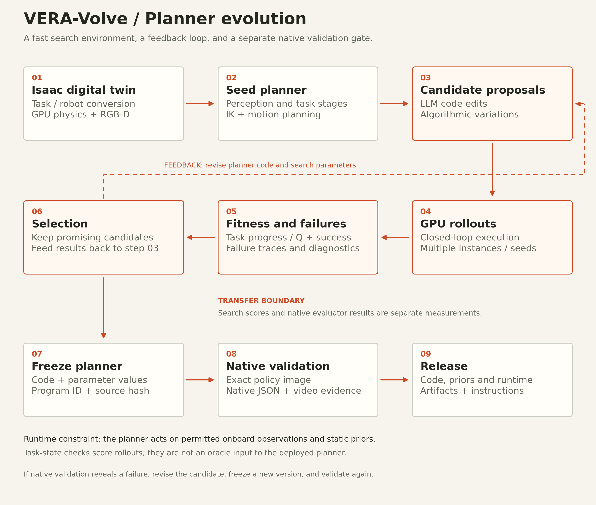

# VERA-Volve for the 2026 BEHAVIOR Challenge

Planner evolution with an Isaac digital twin and native validation

VERA team | November 9, 2026

## Abstract

VERA-Volve develops executable robot planners through a simulation-driven evolution loop. We construct an Isaac digital twin of the task environment for GPU simulation and fast RGB-D rendering, implement an observation-driven seed planner, and search over its logic and parameters. Candidate generation combines LLM-proposed code edits with algorithmic search. Closed-loop rollouts supply task-progress scores, success outcomes and failure traces; promising programs seed the next round. We then freeze a planner artifact and validate its packaged runtime in the native BEHAVIOR-1K evaluator. This report focuses on that planner method and its transfer gate. The source release preserves selected planner implementations, static priors, provenance and native episode evidence. It does not bundle the full digital-twin conversion pipeline or evolution-search history. Search-backend scores and native evaluator measurements are reported separately; no numerical rendering speedup or exact physics-equivalence claim is made.

## 1. Problem and planner representation

The target is the 2026 BEHAVIOR Challenge with the R1Pro robot under BEHAVIOR-1K v3.9.3-post1. A planner must turn onboard observations into a sequence of navigation, grasping and manipulation actions over a long episode. The deployed program receives permitted RGB-D, robot proprioception and relative camera information, together with its packaged static priors, and returns a 23-dimensional robot action.

The search object is executable planner code plus configuration, rather than only a learned action-policy checkpoint. A seed planner contains perception and geometric estimates, task stages, motion targets, and completion or recovery conditions. Its numerical parameters include thresholds, offsets, gains and timeouts. Depending on the task, shared IK and motion-planning routines supply feasible robot motions. The camera-on-tripod planner explicitly separates mutable numerical parameters from its logic.

The released configuration has eight planner routes and two CPU-environment planner routes. The wider submission includes other controllers, but its task coverage is not the subject of the evolution method. At runtime a fixed task route loads the selected planner, while the shared server supplies observation transport, reset behavior, action validation and backend isolation.

<!-- pagebreak -->

## 2. Evolution method scheme



Figure 1. Build the Isaac twin and a seed planner, propose candidates, execute GPU rollouts, score behavior, select and iterate, freeze the selected program, validate natively, and release the packaged artifact. The dashed feedback path returns rollout evidence to LLM and algorithmic candidate generation. The full-size SVG in the project blog expands the contents of each step.

The search environment and native evaluator have different roles. GPU simulation and rendering support repeated candidate execution; native evaluation measures transfer to the challenge runtime. If native validation reveals a problem, revise the program, freeze a new candidate and validate that version again. Simulator task-state checks may score a development rollout, but they are not an oracle input to the deployed planner's action logic.

<!-- pagebreak -->

## 3. Building and searching the planner

### 3.1 Isaac digital twin and GPU observations

The first stage converts the task scene, objects and R1Pro into an Isaac digital twin. Camera placement and RGB-D observations, robot controls, task initialization and task checks define the interfaces that candidate programs use during development. GPU physics and fast rendering make this environment useful for repeated closed-loop candidate screening. The source provenance refers to the H100 SR008 / Isaac Lab port for several recorded evolution results.

The twin is a search backend, not a certificate that contact, dynamics, perception or task transitions exactly match the native simulator. Those differences are tested at transfer. The release records search results and native results separately instead of pooling their episodes or presenting one as a substitute for the other.

### 3.2 Seed planner and candidate generation

The seed planner provides executable task structure. Typical stages include finding target objects from RGB-D, estimating geometry, choosing a base stance, approaching a grasp, closing a gripper, transporting an object, performing the task-specific interaction and recovering when progress stalls. Static robot, object or scene priors and shared IK routines support these decisions where the implementation uses them.

Evolution combines two sources of variation. LLM proposals edit planner logic, stage transitions and recovery behavior. Algorithmic search supplies code or parameter variations, allowing numerical settings to change independently of larger structural edits. The resulting candidate is a concrete program/configuration bundle that can be executed and identified. This method description does not prescribe an unrecorded LLM model, crossover rule, population size or search budget.

### 3.3 GPU rollout, scoring and selection loop

Each candidate runs in a closed loop: render permitted observations, let the planner compute an action, advance the simulated robot and observe the result. Evaluate across task instances or seeds, retaining task progress/Q, success, timeouts and diagnostic traces. Infrastructure errors must remain distinguishable from completed task failures. A search fitness can include development signals, so a combined search score must not be silently relabeled as native final Q.

Retain promising candidates and use execution failures to guide the next proposal round. The feedback can target perception thresholds, motion offsets, stage logic or recovery conditions. Repeating proposal, execution, scoring and selection turns observed robot behavior into the basis for the next program revision. Selected artifacts retain program identities, iterations, source revisions and hashes where recorded; the release does not include every evaluated candidate.

<!-- pagebreak -->

## 4. Freeze and native transfer validation

### 4.1 Validate the actual packaged planner

Freeze the selected code and parameters before a native validation run. Record its program ID, source revision and file or bundle SHA256. Package its dependencies and static priors, then smoke-test that exact policy image against native BEHAVIOR-1K v3.9.3-post1. A search runner or a different image is not the validation target.

Use permitted observations, the expected R1Pro configuration, default horizons, one rollout and one environment. Start a fresh native evaluator process per episode and preserve the full instances 301-310 set with JSON and MP4 output. Planner backends restart per episode through the registry. When a changed planner needs another validation, retain the candidate identity for the new task-level run rather than selecting the luckiest repeated result for each instance.

### 4.2 Search and native measurements

The following task records illustrate why transfer is a separate gate. Search results are recorded H100-port measurements; native results are separate RTX evaluator runs. They reproduce historical runs recorded in the imported task notes, not new experiments or a recomputation of the newer public dataset snapshot.

| Planner task | Recorded search success | Native success / mean Q |
|---|---:|---:|
| Turning on radio | 9 / 10 | 8 / 10; Q 0.80 |
| Attaching a camera to a tripod | 10 / 10 | 6 / 10; Q 0.60 |
| Storing honey | 7 / 10 | 3 / 10; Q 0.30 |
| Installing a scanner | 4 / 10 | 3 / 10; Q 0.40 |

These differences show a transfer gap; the available records do not isolate a single causal explanation. Native notes and solution metadata distinguish the evaluated program, source, hardware and candidate where available. Later native adaptations, including the CPU popcorn and smoke-detector planners, have their own candidate identities and should not be treated as unchanged search champions.

### 4.3 Episode evidence and inspection

The pinned public dataset is VERA-VLA/b1k_final_submission revision `a7e21a893581e5f6a1bf71d8a0e9780530ecf241`. It contains 820 JSON episodes across 82 tasks in the wider submission, with a corresponding video path for each JSON. This is an artifact snapshot, not an asserted official leaderboard score or a planner-only aggregate. The blog defaults to the ten current planner routes and can expose the broader inventory when needed.

The evidence tool reads committed JSON blobs, checks task and instance identity, complete ten-instance sets, Q ranges and success consistency, and records SHA256 hashes. Pairing with video paths checks dataset-tree presence; the entire MP4 collection was not downloaded and decoded. Historical artifacts are not automatically attributed to the current release route.

<!-- pagebreak -->

## 5. Reproducing a released planner

### 5.1 Start with one task

Install the native BEHAVIOR-1K v3.9.3-post1 environment and licensed assets separately. Docker, NVIDIA Container Toolkit and compatible GPU access are required by the planner image. From the repository root, the task-scoped launcher builds the selected policy and runs instance 301 without requiring VLA checkpoint downloads:

```bash
B1K=/absolute/path/to/BEHAVIOR-1K \
B1K_PYTHON=/absolute/path/to/evaluator/python \
INDICES=0 RESULTS_DIR=results_smoke \
bash scripts/run_eval.sh turning_on_radio
```

The launcher supplies the RGBDFullResWrapper and writes native evaluator outputs and container logs. Validate the resulting JSON/video pair with `scripts/check_results.py`. After smoke validation, evaluate indices 0-9 sequentially for instances 301-310. Preserve the exact image identity and use separate containers, policy ports, caches and output directories for concurrent evaluators.

A planner's reproducible artifact includes its source tree, entrypoint, configuration, static priors and runtime. It does not require a language model at deployment merely because LLM edits were used during search. The task folders and source manifest make the selected code inspectable. The release's inherited GPU planner dependencies, cuRobo revision and separate CPU environment pins remain unchanged.

### 5.2 Full submission distribution

The complete public submission image also contains other routes and their model checkpoints. Its immutable digest and extraction instructions are retained in the weights guide for reproducing the full package; those auxiliary learned policies are outside this report's method focus. Use the route-specific wrapper and replay settings in the reproduction guide if evaluating them.

### 5.3 Release verification scope

The source check verifies 1,832 imported entries, including symlink targets and executable modes. The CPU suite has 30 passing tests and four optional external-reference tests skipped. These checks cover source fingerprints, routing, action transport, recovery, checkpoint extraction behavior with simulated Docker operations, and release consistency. They do not run a physical task or substitute for native simulator validation.

The diagram and report are explanatory additions. Their preparation did not rerun the original evolution search, rebuild the full GPU submission image or collect new native rollouts. Reported success rates refer to the task records and public artifacts identified above.

<!-- pagebreak -->

## 6. Limits and reproducibility requirements

The source release preserves selected planner outputs of evolution. It does not contain a self-contained copy of the Isaac twin conversion pipeline, full search driver, prompts, complete candidate archive or every development rollout. Repeating the entire search would additionally require those components, exact task conversion settings, mutation/search budgets, scoring definitions and compute configuration. The nine-step scheme describes the method; its stages should not be mistaken for a claim that all search infrastructure is bundled here.

Search-backend and native task outcomes remain separate. No numerical GPU rendering speedup, exact physics match or held-out improvement guarantee is inferred from the available records. Repeated adaptive search on particular instances can favor those instances, and simulator or rendering variability can affect a native rerun. The task notes retain both strong results and failures.

The runtime observation boundary also matters. A development simulator can access task predicates to score a rollout, while the deployed planner acts on permitted sensor observations and static priors. A controller that reads live ground-truth object state would be a different policy. The release description does not replace this boundary with an oracle controller.

Finally, the original Apache-2.0 root license and component notices are preserved. Model, tokenizer, simulator and dataset terms remain separate. Simulator assets are obtained through the upstream installation rather than redistributed with the planner source.

## References and artifact index

1. [BEHAVIOR Challenge 2026](https://behavior.stanford.edu/challenge/index.html) and [BEHAVIOR-1K v3.9.3-post1](https://github.com/StanfordVL/BEHAVIOR-1K/tree/v3.9.3-post1), the native evaluation target.

2. [VERA-Volve source release](https://github.com/wingrune/VERA-B1K-2026), imported from alstar8/b1k_evo_submit commit 309bb650dc1606319a4309d5b0ab64702f8ad6ab. The source manifest identifies preserved entries.

3. [Turning-on-radio task record](https://github.com/wingrune/VERA-B1K-2026/blob/main/tasks/turning_on_radio/README.md) and [camera-on-tripod task record](https://github.com/wingrune/VERA-B1K-2026/blob/main/tasks/attach_a_camera_to_a_tripod/README.md), with selected program provenance and recorded evolution results. The native camera result is retained in the archived source README and public artifacts.

4. [Storing-honey task record](https://github.com/wingrune/VERA-B1K-2026/blob/main/tasks/store_honey/README.md) and [scanner task record](https://github.com/wingrune/VERA-B1K-2026/blob/main/tasks/installing_a_scanner/README.md), including transfer evidence and source metadata.

5. [Pinned VERA validation snapshot](https://huggingface.co/datasets/VERA-VLA/b1k_final_submission/tree/a7e21a893581e5f6a1bf71d8a0e9780530ecf241), with unedited episode JSONs and videos. Per-file JSON hashes and source revision are published alongside this report.

6. [cuRobo](https://github.com/NVlabs/curobo) and task-level BIMBO_EvoX / B1K_hacker provenance records identify planning dependencies and selected program origins. Broader controller and model acknowledgments remain in the release's third-party notices.
